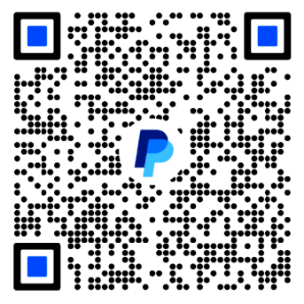

# NinjaSight Pro

**An offline Windows photo viewer, annotation editor and batch image resizer.**

Open instantly. View naturally. Annotate precisely. Resize efficiently. Save everything. Continue editing anytime.

NinjaSight Pro is a lightweight, locally operated image viewer and editing application designed to make everyday image management faster and more intuitive.

- **100% offline:** no accounts, cloud services, telemetry or internet connection required.
- **Privacy first:** all image processing takes place locally on your computer.
- **Broad format support:** including HEIC, HEIF, AVIF, JPEG 2000 and professional camera RAW formats.
- **No commercial dependencies:** image processing relies on free and open-source libraries.
- **Editable projects:** save your work and continue editing whenever you want.

## Features

### 1. Floating Image Viewer

A clean, borderless, translucent overlay that keeps your pictures in focus while allowing you to work directly on your desktop.

**Supported formats:**

- Standard: JPG, JPEG, PNG, BMP.
- Web formats: WEBP, AVIF, GIF.
- Professional formats: TIFF, TIF, TGA.
- Apple formats: HEIC, HEIF, including iPhone image sequences.
- JPEG 2000: JP2, J2K, JPF, JPX.
- Camera RAW: DNG, CR2, CR3, CRW, NEF, NRW, ARW, SRF, SR2, ORF, RW2, RAF, PEF, SRW, ERF, KDC, DCR, MRW, 3FR, IIQ, MOS, MEF, RWL and ARI.

All supported formats can be viewed, edited and saved.

**Image processing and compatibility:**
- Automatic EXIF orientation correction.
- HEIF container rotation support.
- Colour profile conversion to sRGB where required.
- HEIC image sequences with Ctrl + Left/Right.
- Camera RAW files are never overwritten. Edits are saved as DNG or exported to another supported format.

**Navigation and interaction:**
- Smooth mouse-wheel zoom centred on the cursor.
- Drag-to-pan and middle-button navigation.
- Double-click to enter fullscreen.
- Right-click context menu.
- Folder navigation using arrow keys.
- Background prefetching for faster image loading.
- Thumbnail strip and floating information overlay.
- Multiple independent viewer windows (Ctrl + N).
- Drag and drop support for files and folders.

**Image Browser (B):**
- Folder-based thumbnail grid.
- Sorting by name, date, size and file type.
- Recent files and projects.
- Favourites.

### 2. Image Annotation Editor

A comprehensive annotation environment with non-destructive editing.

**Available tools:**
- Text boxes and callouts.
- Freehand pen and highlighter.
- Lines, arrows and double arrows.
- Rectangles, ellipses and circles.
- Numbered markers.
- Area highlighting and spotlight.
- Blur and pixelation.

**Object management:**
- Select, move, resize and rotate objects.
- Multi-selection using Shift or rubber-band selection.
- Duplicate, copy and paste.
- Bring forward and send backward.
- Group and ungroup.
- Undo and redo (Ctrl + Z / Ctrl + Y).
- Precise keyboard positioning.
- Dedicated Objects Panel (O) for listing, renaming, hiding and reordering objects.

Annotations are always stored as separate editable objects. The original picture remains untouched.

### 3. NinjaSight Project Format (.pvp)

Save complete editing sessions in a dedicated ZIP-based project format.

Each project contains:

| Component | Description |
|---|---|
| `mimetype` | Project MIME type |
| `manifest.json` | Format version, application version, timestamps, SHA-256 checksums and entry sizes |
| `original_image/` | Original image, preserved byte-for-byte |
| `annotations.json` | Editable annotations, groups, rotation and image dimensions |
| `metadata.json` | Title, source information, EXIF summary and resize history |
| `preview.jpg` | Flattened 512 px preview for thumbnails |

**Reliability and recovery:**
- Forward compatibility: unknown fields from newer versions are preserved when saving.
- Safe saving with temporary files, checksum verification and backup protection.
- Automatic recovery detection after interrupted saves.
- Automatic annotation recovery every 30 seconds (configurable).
- Recovery prompt after unexpected application shutdown.

### 4. Image Resizer

A fast and flexible resizing engine inspired by Fast Image Resizer.

**Single-image resizing:**
- Resolution presets (3840 × 2160 down to 640 × 480).
- Custom dimensions.
- Percentage-based resizing.
- Fit within and fill & crop modes.
- Interactive crop preview.
- Width-only and height-only resizing.
- Longest-side resizing.
- Don't enlarge option.
- Portrait-aware presets.

**Resampling algorithms:**
- Lanczos.
- Bicubic.
- Bilinear.
- Nearest neighbour.
- Optional sharpening after resizing.

**Output formats:**
- Original format.
- JPEG (quality 1–100).
- PNG (lossless).
- WEBP (lossy/lossless).
- BMP.
- TIFF.
- HEIC.

Additional options:
- Preserve or strip EXIF metadata.
- Preserve colour profiles.
- Custom background colour for transparent images.
- Live preview of output dimensions and scaling percentage.
- Estimated output file size.

**Project resizing:**

Two different workflows are available:

- **Resize Project:** scales the original picture and all annotations while preserving full editability.
- **Export Resized Annotated Image:** exports a flattened image containing the resized picture and annotations.

**Batch Processing (Ctrl + B):**
- Process multiple files and folders, including subfolders.
- Drag-and-drop file management.
- Queue preview and selective removal.
- Custom naming patterns: `{name}`, `{suffix}`, `{width}`, `{height}`, `{percent}`, `{counter}`, `{date}`, `{format}`, `{ext}`.
- Output to the original folder, a subfolder or a custom destination.
- Preserve the original folder structure.
- Optional replacement of original files with explicit confirmation.
- Conflict management: rename, skip or overwrite.
- Multi-threaded processing.
- Live progress reporting.
- Safe cancellation without corrupting completed files.
- Reusable processing profiles.
- Optional local upscaling before resizing.
- Preserve original file dates.
- Text and image watermarks with live preview.
- Estimate output size before processing.

### 5. Export

Export images and projects in:

- PNG
- JPEG
- WEBP
- PDF

Available options:
- With or without annotations.
- Custom output resolution or percentage scaling.
- Quality settings.
- PDF page sizes: A4, A3, A5, Letter, Legal or Fit.
- Portrait and landscape orientation.
- Custom margins.
- 1, 2, 4, 6 or 9 images per page.
- Captions.
- Multiple files and projects in a single operation.

### 6. Windows Integration

Optional Windows Explorer integration, configurable from Settings.

No administrator rights are required for per-user integration.

Available features:
- Open with NinjaSight Pro.
- Right-click menu: Open with NinjaSight Pro.
- Right-click menu: Resize with NinjaSight Pro.
- Folder context menu: Batch resize with NinjaSight Pro.
- Find duplicates with NinjaSight Pro.
- Screenshot commands on desktop and folder context menus.
- `.pvp` project file association.
- Default application registration.

Paths containing spaces and non-ASCII characters are fully supported.

### 7. Screenshot Capture

A native screenshot capture system designed for fast and precise screen grabbing.

The capture interface works independently of the main NinjaSight Pro window and freezes the desktop at its actual resolution.

**Capture modes:**
- Selected area.
- Entire desktop (all monitors).
- Individual monitor.

**Selection tools:**
- Pixel-accurate selection.
- Live width and height information.
- Shift to constrain selection to a square.
- Automatic aspect-ratio snapping (1:1, 3:2, 2:3, 4:3, 16:9 and more).
- Space to capture the entire desktop.
- M to select the monitor under the mouse.
- Esc or right-click to cancel.

**After capture:**
- Save directly.
- Save as.
- Copy to clipboard.
- Open in NinjaSight Edit.
- Quick Share, when available.

**System-wide shortcut:**

Default: `Ctrl + Shift + X`

The shortcut is configurable and supports multiple key combinations.

Additional features:
- Dedicated camera button.
- Windows desktop and folder context menu integration.
- Configurable default screenshot destination.
- Per-monitor DPI awareness.
- Smooth selection rendering with partial screen repainting.
- Optional automatic HDR screenshot correction.

**Always Ready mode:**

An optional lightweight background helper starts with Windows and waits for the screenshot shortcut, even when NinjaSight Pro is closed.

When the application is already running, its main window handles the shortcut directly.

The helper is automatically stopped and removed when the application is uninstalled.

### 8. Advanced Retouching Tools

Additional image correction and restoration capabilities.

**Eyedropper:**
- Pick colours directly from the image.

**Clone Stamp:**
- Alt + click to select a source area.
- Paint over unwanted areas.
- Zoom and image positioning remain unchanged between strokes.

**Patch Tool:**

Two operating modes:

- **Rectangle:** select a damaged area, drag it onto a clean area and preview the seamless replacement.
- **Brush:** paint the damaged area using a resizable soft brush, with multiple passes. Alt or Erase removes parts of the selection. Apply the replacement only when the selection is complete.

**Pen stroke processing:**
- Smooth and normalize freehand strokes.
- Convert strokes into editable vector curves.
- Adjust curve points and direction handles.
- Alt to create corner points.
- Remove handles without changing the existing curve.

**Spotlight:**
- Rectangular or circular areas.
- The surrounding image is darkened only once, regardless of the number of spotlight areas.

**Advanced shapes and arrows:**
- Multiple arrowhead styles.
- Independent arrowhead configuration for each end.
- Adjustable arrowhead size.
- Tapered lines.
- White outlines.
- Soft blurred shadows.
- Adjustable rotation and angle.

**Text and typography:**
- Any font installed in Windows.
- Font selection and quick access to the three most frequently used fonts.
- Adjustable colours, alignment, backgrounds, borders and shadows.

### 9. Photo Adjustment Panel

An integrated photo correction panel, accessible through the shutter icon.

Available adjustments:
- Crop.
- Perspective correction.
- White balance.
- Levels.
- Curves.
- Edge-aware sharpness.
- HDR correction slider.
- Image upscaling.

**HDR Fix:**

Designed to correct washed-out or excessively bright screenshots captured from HDR monitors.

- 0: Disabled.
- 50: Standard correction.
- 100: Strong correction.

The correction adjusts levels, midtones and saturation while preserving highlights at the standard setting.

**Upscaling:**

Local image upscaling with detail recovery:

- 1.5×
- 2×
- 3×
- 4×

All calculations are performed locally on the computer.

The histogram remains visible in the bottom-left corner above the thumbnail strip.

### 10. Watermark

Integrated watermark functionality in the Resize panel and Batch Processor.

Supported watermark types:
- Text.
- Images.

Available positioning:
- Nine standard positions.
- Tiled grid.
- Diagonal repetition.
- Bottom strip.

Customizable:
- Opacity.
- Size.
- Rotation.
- Spacing.

### 11. Collage

Create image collages using a visual composition interface.

Features:
- Live composition preview.
- Numbered images in their arranged order.
- Include the currently displayed central image in the composition.
- Exclude individual images using the selection list.
- Swap images by dragging one onto another.
- Reorder images using the up/down controls.

**Collage settings:**
- Custom output folder (default: `Pictures\Collage`).
- Custom filename patterns.
- Automatic saving or confirmation before saving.
- Option to open the resulting collage automatically.

### 12. Printing

A dedicated print interface with accurate previews.

Features:
- Real printer paper size and printable-area preview.
- Page thumbnails.
- Printer selection.
- Copies and paper settings.
- Portrait and landscape orientation.
- Direct access to printer properties.
- 1, 2, 4, 6, 9, 12 or 20 images per page.
- Adjustable margins and spacing.
- Custom filenames.
- Drag-and-drop image repositioning.
- Swap images between frames and pages.
- Rotate, fit or fill individual images.
- Add or remove images from frames.

The final output is rendered according to the selected printer's actual printable area.

### 13. Multiple Monitors and Small Screens

NinjaSight Pro supports multi-monitor environments.

- Move the application between monitors using the monitor button, right-click menu or Ctrl + Shift + M.
- Displays monitors according to their Windows arrangement.
- Remembers the last selected monitor.
- Automatically scales the interface on low-resolution displays.
- Configurable scaling in Settings.

## Installation

### Windows Installer

Run:

`NinjaSightPro-Setup-<version>.exe`

Example:

`NinjaSightPro-Setup-1.2.2.exe`

Two installation modes are available:

**Only me**
- Installs in `%LOCALAPPDATA%\Programs\NinjaSight Pro`.
- No administrator rights required.
- Settings stored per user.

**All users**
- Installs in `Program Files\NinjaSight Pro`.
- Requires administrator rights.

The installer also allows you to select Explorer integrations and shortcuts.

An uninstaller is registered in Windows Apps & Features.

### Updating

Run the new installer.

If NinjaSight Pro is already installed, the installer offers a one-click **Update now** option.

Updates preserve:
- Installation location.
- User settings.
- Explorer integration.
- Shortcuts.
- Screenshot shortcut configuration.

Open application windows automatically reopen using the new version. Windows with unsaved work remain active until closed.

### Command-line Installation

```bash
NinjaSightPro.exe --install
NinjaSightPro.exe --install-all-users
NinjaSightPro.exe --uninstall
NinjaSightPro.exe --uninstall-all-users
NinjaSightPro.exe --register
NinjaSightPro.exe --unregister
```

## Command Line

NinjaSight Pro supports command-line operations.

```bash
NinjaSightPro.exe [file or folder]
```

Open a picture, project or folder.

```bash
NinjaSightPro.exe --resize <file>
```

Open a file directly in the Resize panel.

```bash
NinjaSightPro.exe --batch <files/folders>
```

Open the Batch Processor with a predefined queue.

```bash
NinjaSightPro.exe --selftest <folder>
```

Run the built-in end-to-end tests.

```bash
NinjaSightPro.exe --screenshot <png> [file]
```

Capture approximately 120 frames, save the window image and exit.

```bash
NinjaSightPro.exe --shot area|whole|monitor|menu
```

Launch the screenshot capture interface.

## Keyboard Shortcuts

Some of the main shortcuts:

| Shortcut | Function |
|---|---|
| Ctrl + N | Open a new viewer window |
| Ctrl + B | Open Batch Processor |
| Ctrl + Z | Undo |
| Ctrl + Y | Redo |
| Ctrl + Shift + X | Screenshot capture (configurable) |
| Ctrl + Shift + P | Print |
| Ctrl + Shift + M | Move to another monitor |
| B | Open Image Browser |
| O | Open Objects Panel |
| G | Vignette |
| M | Magnifier |

Additional shortcuts can be configured in Settings.

## Changelog

### Version 1.2.7

**Printing**
- New print interface with accurate printer previews.
- Support for 1, 2, 4, 6, 9, 12 or 20 pictures per page.
- Direct printer configuration and page management.
- Drag-and-drop image rearrangement.
- Individual image rotation, fitting and filling.

**Thumbnail Carousel**
- Central image enlarged by 1.5×.
- Automatic thumbnail resizing after inactivity.
- More transparent strip background.

### Version 1.2.6

**Thumbnail Carousel**
- Central thumbnail frame remains fixed.
- Images slide through the central frame.
- Selected image appears 30% larger.
- Smooth resizing of neighbouring thumbnails.
- Mouse-wheel navigation.

**Interface**
- Consistent central toolbar positioning.
- Improved file information overlay.
- Enhanced text note alignment and background controls.
- Number badges can be positioned in eight locations.

**Find Duplicates**
- Full-window interface.
- Comparison grid supporting up to 16 images.
- Synchronized zoom and pan.
- Easier duplicate selection and removal.

**Printing**
- Print individual pictures or entire folders.
- Print with or without annotations.
- Fit or fill page options.
- Automatic page orientation.
- Margin configuration.

**Screenshot**
- Improved pointer visibility.
- Screenshot shortcut displayed on the start screen.

**Stability**
- Fixed a crash involving newly created callouts and text notes.
- Unexpected errors are now recorded in `crash.log`.

### Version 1.2.2

**Image Browser**
- Integrated file browser for opening pictures and projects.
- File browser for batch processing, export, slides, duplicates and watermark images.
- Integrated folder selection.
- Improved Save As workflow.
- New folder creation and overwrite confirmation.

**Editing**
- New Clone Properties tool.
- Copy visual properties from one object to another.
- Ctrl to apply properties to multiple objects.
- Ctrl-assisted rotation in 15-degree increments.
- Improved object sizing consistency across interface layouts.

**Interface**
- Improved Shapes and Symbols menu.
- Reorganized application settings.
- Updated start screen with keyboard shortcuts.

### Version 1.2

**Typography and editing**
- Independent font colour for text notes and callouts.
- Configurable number colour for markers.
- Improved clipboard support with Ctrl + X, Ctrl + C and Ctrl + V.
- Added Vignette tool.
- Added Magnifier tool.
- Improved Patch Brush workflow.
- Enhanced system font picker.

**Shapes and Symbols**
- New architecture symbols.
- Industrial safety signs.
- Road signs.
- Emergency and fire safety symbols.
- Business and office icons.
- Packaging and handling symbols.

**Collage**
- Improved composition preview.
- Drag-and-drop image swapping.
- Image reordering.
- Configurable saving options.

## Development

NinjaSight Pro is developed privately by **Oneshotblu**, with the assistance of AI development tools.

The project is developed on a non-commercial basis.

The application uses free and open-source image-processing libraries, including:

| Component | Library | Licence |
|---|---|---|
| AVIF decoding | avif-parse / rav1d | MPL-2.0 / BSD-2 |
| AVIF encoding | rav1e / ravif | BSD |
| JPEG 2000 | dicom-toolkit-jpeg2000 | MIT / Apache |
| Camera RAW | rawler | LGPL-2.1 |
| TGA / GIF / TIFF | image | MIT / Apache |

No commercial image-processing licences are required.

Individual library licences and their respective copyright notices should be consulted for complete licensing information.

## Support the Project 🍺

NinjaSight Pro is developed independently and shared without commercial ambitions.

If you find it useful and would like to support its development, you can spontaneously offer me a beer!

There is absolutely no obligation. Every contribution, regardless of its size, is appreciated.

**Satispay**

Send a voluntary donation to:

**@filippopanza**

Scan the QR code below:


**PayPal**

Prefer PayPal? Scan the QR code below to make a voluntary contribution:



**Thanks for your support!**

---

*Developed independently by Oneshotblu. Made with passion, shared freely.*
